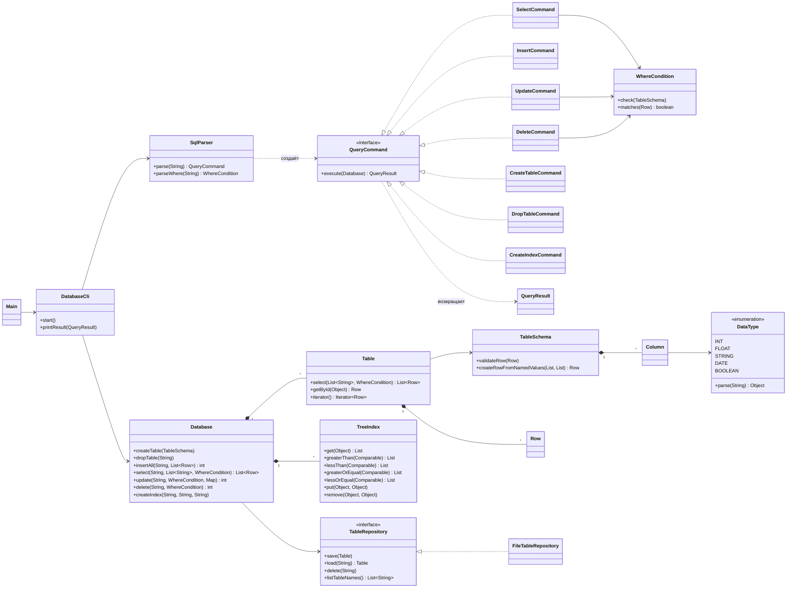
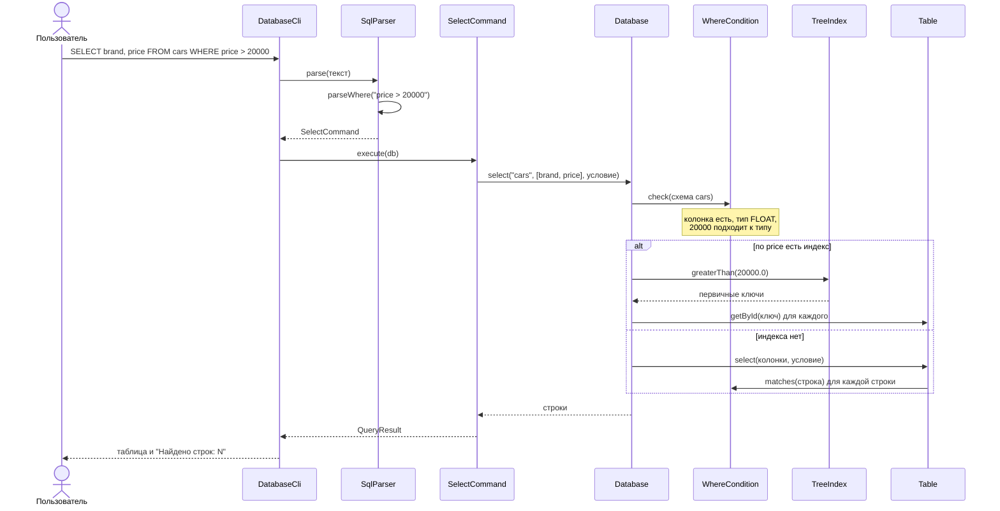

# java-lab2

Вторая лабораторная работа по дисциплине "Программирование на Java": упрощённая СУБД с консольным интерфейсом и SQL-подобным языком запросов.

Что умеет программа:

- хранит таблицы с типами INT, FLOAT, STRING, DATE (формат YYYY-MM-DD) и BOOLEAN;
- связывает таблицы внешним ключом (REFERENCES) и следит, чтобы ссылки не ломались;
- выполняет CREATE TABLE, DROP TABLE, INSERT, SELECT, UPDATE, DELETE и CREATE INDEX;
- сохраняет таблицы и индексы на диск после каждого изменения и загружает их при запуске;
- ускоряет SELECT индексом, если условие стоит по проиндексированной колонке.

## Содержание

1. [Архитектура](#архитектура)
2. [Тестирование производительности](#тестирование-производительности)
3. [Инструкция пользователя](#инструкция-пользователя)
4. [Распределение работы](#распределение-работы)
5. [Выводы](#выводы)
6. [Источники](#источники)

## Архитектура

Программа разделена на слои:

| Пакет | Что внутри |
|---|---|
| org.example | точка входа Main, консоль DatabaseCli, замеры Benchmark, демонстрация StorageDemo |
| org.example.sql | парсер SqlParser и команды: по одному классу на каждый вид запроса |
| org.example.model | данные: Row, Column, DataType, TableSchema, WhereCondition, QueryResult |
| org.example.storage | хранение: Database, Table, TableRepository, FileTableRepository, TreeIndex |
| org.example.exception | SqlException (ошибка в тексте запроса) и DatabaseException (база отказалась выполнять запрос) |

Использованные паттерны:

- **Command** - каждый разобранный запрос превращается в объект, реализующий QueryCommand, и консоль просто вызывает у него execute;
- **Repository** - Database работает с таблицами на диске через интерфейс TableRepository, а как именно они хранятся, знает только FileTableRepository;
- **Iterator** - Table реализует Iterable<Row>, поэтому её можно обойти циклом for (Row row : table). Отдаются копии строк, чтобы данные нельзя было поменять в обход проверок.

### Диаграмма классов



### Как выполняется запрос

Пример: SELECT brand, price FROM cars WHERE price > 20000, когда по `price` есть индекс.



Запросы, которые меняют данные проходят так же, только Database ещё:

1. проверяет внешние ключи: нельзя сослаться на несуществующую запись и нельзя удалить запись, на которую ссылаются;
2. обновляет все индексы таблицы;
3. сразу сохраняет таблицу и её индексы на диск.

### Хранение на диске и надёжность

- Каждая таблица лежит в своём файле data/<имя>.db, каждый индекс в data/<имя_индекса>.idx. Используется стандартная сериализация Java (Serializable).
- Таблица сначала пишется во временный файл .db.tmp, а потом одним Files.move заменяет старый. Если программа упадёт посреди записи, старый файл останется целым.
- Если при запуске файл индекса повреждён или пропал, индекс строится заново по данным таблицы и сразу сохраняется.
- Если повреждён файл таблицы, программа не падает: она запускается без этой таблицы и пишет, что именно не загрузилось.

### Индекс

TreeIndex построен на TreeMap: значение колонки -> список первичных ключей строк с этим значением. Поиск по значению занимает O(log N). Так как TreeMap держит ключи отсортированными, для >, <, >= и <= достаточно взять часть дерева через tailMap и headMap, без просмотра всей таблицы. Значения NULL в индекс не попадают.

## Тестирование производительности

Замеры делает org.example.Benchmark. Он создаёт таблицу cars на 50 000 строк со случайными данными (brand - одна из 5 марок, price - от 10 000 до 100 000) и замеряет одни и те же запросы до и после создания индекса. Перед замерами есть прогрев, каждый запрос повторяется много раз, в таблице суммарное время всех повторов.

| Запрос | Повторов | Найдено строк | Без индекса | С индексом | Ускорение |
|---|---:|---:|---:|---:|---|
| brand = 'BMW' | 100 | 9 978 (20%) | 63 мс | 102-110 мс | в 0,6 раза, то есть медленнее |
| price = 14041.0 | 1 000 | 1 | 354-359 мс | меньше 1 мс | больше чем в 350 раз |
| price > 99000.0 | 100 | 525 (1%) | 113-116 мс | 8 мс | в 14-16 раз |

Построение индекса по brand вместе с сохранением таблицы и индекса на диск заняло около 1,8 с.

Что видно по результатам:

- Индекс сильно выигрывает, когда условию подходит мало строк. Для точного совпадения по цене поиск по дереву вместо просмотра 50 000 строк дал ускорение на несколько порядков, для узкого диапазона примерно в 15 раз.
- Когда подходит каждая пятая строка (brand = 'BMW'), индекс проигрывает. Найденных ключей почти 10 000, и для каждого строка отдельно достаётся по первичному ключу и копируется. Это дороже, чем один проход по таблице. В настоящих СУБД при низкой селективности оптимизатор тоже часто отказывается от индекса.
- Индекс не бесплатный: его надо построить и поддерживать при каждой вставке, изменении и удалении.

Запустить замеры самому:

```bash
java -cp target/classes org.example.Benchmark
```

## Инструкция пользователя

### Требования

- JDK 17 или новее;
- Maven 3 (или IntelliJ IDEA, в ней Maven уже встроен).

### Сборка и запуск

```bash
mvn compile
```

```bash
java -cp target/classes org.example.Main
```

В IntelliJ IDEA можно просто открыть проект и запустить метод main в классе Main.

Данные хранятся в папке data рядом с местом запуска. Чтобы начать с пустой базы, удалите эту папку.

Тесты (JUnit 5):

```bash
mvn test
```

Демонстрация слоя хранения без парсера (данные пишутся во временную папку и удаляются в конце):

```bash
java -cp target/classes org.example.StorageDemo
```

### Пример работы

```
Мини-СУБД. Введите SQL-запрос или exit для выхода.
db> CREATE TABLE manufacturers (id INT PRIMARY KEY, name STRING, founded DATE);
Таблица manufacturers создана (7 мс)
db> CREATE TABLE cars (id INT PRIMARY KEY, brand STRING, price FLOAT, in_stock BOOLEAN, manufacturer_id INT REFERENCES manufacturers(id));
Таблица cars создана (0 мс)
db> INSERT INTO manufacturers VALUES (1, 'Toyota', '1937-08-28');
Задействовано строк: 1 (3 мс)
db> INSERT INTO cars VALUES (1, 'Toyota', 25000.0, TRUE, 1);
Задействовано строк: 1 (2 мс)
db> INSERT INTO cars (id, brand) VALUES (2, 'BMW');
Задействовано строк: 1 (0 мс)
db> SELECT * FROM cars;
id | brand | price | in_stock | manufacturer_id
-----------------------------------------------
1 | Toyota | 25000.0 | true | 1
2 | BMW | NULL | NULL | NULL
Найдено строк: 2 (0 мс)
db> SELECT brand, price FROM cars WHERE price > 20000;
brand | price
-------------
Toyota | 25000.0
Найдено строк: 1 (0 мс)
db> UPDATE cars SET price = 30000 WHERE id = 2;
Задействовано строк: 1 (1 мс)
db> DELETE FROM cars WHERE brand = 'Toyota';
Задействовано строк: 1 (1 мс)
db> CREATE INDEX idx_cars_brand ON cars (brand);
Индекс idx_cars_brand создан (1 мс)
db> INSERT INTO cars VALUES (3, 'Kia', 15000.0, TRUE, 7);
Не получилось: В таблице 'manufacturers' нет записи с id = 7, сначала добавьте её
db> exit
До встречи!
```

### Поддерживаемые команды

| Команда | Пример |
|---|---|
| Создать таблицу | CREATE TABLE cars (id INT PRIMARY KEY, brand STRING, manufacturer_id INT REFERENCES manufacturers(id))` |
| Удалить таблицу | DROP TABLE cars` |
| Вставить строки | INSERT INTO cars VALUES (3, 'Kia', 15000.0, TRUE, 1), (4, 'Audi', 40000.0, FALSE, 1) |
| Вставить только часть колонок | INSERT INTO cars (id, brand) VALUES (3, 'Kia') |
| Выбрать | SELECT * FROM cars, SELECT brand, price FROM cars WHERE price > 20000 |
| Изменить | UPDATE cars SET price = 30000 WHERE id = 2 |
| Удалить строки | DELETE FROM cars WHERE brand = 'Toyota' |
| Создать индекс | CREATE INDEX idx_cars_brand ON cars (brand) |
| Выйти | exit |

Правила и ограничения:

- регистр ключевых слов, имён таблиц и колонок не важен, ';' в конце не обязательна;
- строки и даты пишутся в одинарных кавычках: 'BMW', '2023-05-10'; NULL без кавычек - это пустое значение, а 'NULL' - обычная строка;
- в каждой таблице ровно один PRIMARY KEY, внешний ключ может ссылаться только на первичный ключ другой таблицы того же типа;
- в WHERE одно условие с оператором '=', '!=', '>', '<', '>=' или '<='; '>', '<', '>=' и '<=' работают только с числовыми колонками;
- UPDATE меняет одну колонку за раз, первичный ключ менять нельзя;
- UPDATE и DELETE всегда пишутся с WHERE;
- индекс используется в SELECT для условий '=', '>', '<', '>=' и '<=' по проиндексированной колонке.

Ошибки делятся на два вида: "Ошибка в запросе" - запрос написан неправильно, "Не получилось" - запрос понятен, но база не может его выполнить (нет таблицы, повторился первичный ключ, сломалась бы ссылка и т.п.).

## Распределение работы

| Участник | Область ответственности |
|---|---|
| Ашихмина Елизавета | основа Maven-проекта и консольный цикл, вывод результатов в виде таблицы, индекс TreeIndex с поиском по диапазону, замеры Benchmark, тесты индекса |
| Анна Немцева| разбор SQL, команды (QueryCommand и все *Command), исключение, тесты парсера |
| Анастасия Безусова | слой хранения: модель данных, первичные и внешние ключи, сохранение и загрузка с диска, восстановление индексов, условие WhereCondition, тесты хранения и StorageDemo |

## Выводы

- Сделана работающая упрощённая СУБД: таблицы с пятью типами данных, первичные и внешние ключи, SQL-подобные запросы, хранение на диске и индексы.
- Разделение на слои (парсер -> команды -> база -> хранилище) позволило работать втроём почти независимо.
- Индекс на TreeMap получился простым и закрывает и точный поиск, и диапазоны. 
- Сохранение после каждого изменения и запись через временный файл дают надёжность ценой скорости.

## Источники

1. Документация Java SE 17: [java.util.TreeMap](https://docs.oracle.com/en/java/javase/17/docs/api/java.base/java/util/TreeMap.html), [java.io.Serializable](https://docs.oracle.com/en/java/javase/17/docs/api/java.base/java/io/Serializable.html), [java.nio.file.Files](https://docs.oracle.com/en/java/javase/17/docs/api/java.base/java/nio/file/Files.html).
2. [Java Object Serialization Specification](https://docs.oracle.com/en/java/javase/17/docs/specs/serialization/index.html).
3. [JUnit 5 User Guide](https://junit.org/junit5/docs/current/user-guide/).
4. [Документация Mermaid](https://mermaid.js.org/) - для диаграмм в этом файле.
